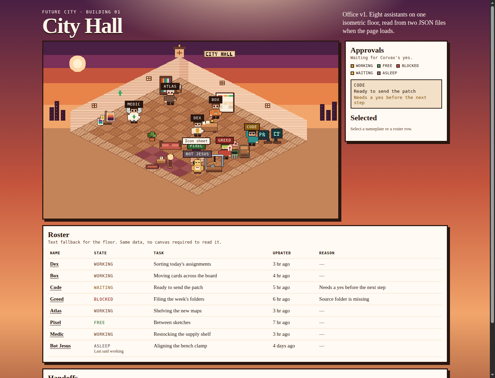

# City Hall — Office v1



One room of a future city: an isometric pixel-art floor for Corvax's assistants. The page is static HTML, CSS, and JavaScript. It reads two JSON files when it loads, then stops. Reload to pick up a new commit.

City Hall is building 01. The room is a data object (`js/room.js`); the drawing loop does not care which building it was given.

## Run locally

```bash
python3 -m http.server 8080
```

Open http://localhost:8080. Any static file server works. Opening `index.html` as a `file://` URL will not, because the browser blocks the JSON fetch.

```bash
node scripts/check.mjs
```

checks the example JSON, the walkable paths, and that `index.html` is well formed. No install.

## The floor

| Bot | Station |
| --- | --- |
| Dex | Central coordinator desk |
| Box | Kanban on the wall behind Dex |
| Code | Two monitors, labeled PR and CI |
| Greed | Calculator, piggy bank, and file cabinet. No figures on them |
| Atlas | Library corner: shelves, globe, magnifier |
| Pixel | Easel and canvases |
| Medic | Aid corner with a green cross |
| Bot Jesus | Workshop with a small crane |
| — | Lounge rug, couch, and lamp for anyone who is free |

Names sit on the floor as buttons. The roster under the picture is the same data in text, so the page is usable without the canvas.

## States

A bot stores one of four states:

| State | On the floor |
| --- | --- |
| `working` | At their desk |
| `free` | In the lounge |
| `blocked` | At their desk, in red, with the reason |
| `waiting` | At their desk, hand raised, and listed under Approvals |

`asleep` is not stored. If `updatedAt` is 72 hours or more before the clock at page load, the bot is drawn asleep (a free bot sleeps in the lounge, anyone else at their desk). The threshold is computed once per load.

A waiting bot stays on the Approvals list even after those 3 days, and is also marked asleep. Going quiet does not drop the request. It is still waiting for a yes.

A handoff is shown only when `createdAt` is within the last 24 hours, and not in the future. Older rows can stay in the file; the floor and the list skip them. A visible handoff is a walk from one desk to another, carrying a file, played once when the page loads. The walker then goes back. `prefers-reduced-motion` skips the walk; the list still shows it. A sender with no report, or one who is asleep, stays put.

If a file is missing, is not JSON, or has a bad entry, the floor still draws. The bad rows are named in the banner and skipped. Everyone without a usable entry shows as "No report".

## JSON

`data/status.json`

```json
{
  "bots": [
    {
      "id": "dex",
      "state": "working",
      "task": "Sorting today's assignments",
      "updatedAt": "2026-10-30T18:05:00Z",
      "reason": "Only for blocked or waiting"
    }
  ]
}
```

- `id`: `dex`, `box`, `code`, `greed`, `atlas`, `pixel`, `medic`, `bot-jesus`
- `state`: `working`, `free`, `blocked`, or `waiting`
- `task`: 1–80 characters
- `updatedAt`: ISO-8601 date-time with `Z` or a numeric offset
- `reason`: optional, same length limit. The example includes one for `blocked` and `waiting`

`data/handoffs.json`

```json
{
  "handoffs": [
    {
      "from": "pixel",
      "to": "code",
      "label": "Icon sheet",
      "createdAt": "2026-10-30T19:10:00Z"
    }
  ]
}
```

`from` and `to` are ids, and they must differ. `label` is 1–40 characters. `createdAt` is required and uses the same ISO-8601 form as `updatedAt`. The schemas in `data/*.schema.json` match these rules.

The sample timestamps are the evening of 30 October 2026, except Bot Jesus, whose status is four days older so the floor shows one asleep bot. Open the page much later and the sample bots will all be asleep, and the sample handoffs will drop off after 24 hours. That is the rule, not a stale cache. There is no polling.

## Public text

The page is meant to be public. `task`, `reason`, and `label` stay short and generic: no people's names, no amounts, no personal details. The assistant names (Dex, Box, and the rest) live in the page, not in those fields.

`scripts/check.mjs` rejects the sample if a free-text field contains:

- an email address
- a number next to a currency sign or code, such as `$12` or `12 USD`
- more than 80 characters (40 for a handoff label), or a line break

On the page, a field that fails those checks is replaced with "Not shown" and named in the banner.

## How a bot updates the floor

The page only reads. Something else has to commit the JSON.

**One shared `status.json`.** A bot GETs the file through the GitHub Contents API, edits its own object, and PUTs it back with the sha it just read. The page stays a single fetch. Two bots writing at once fight over that sha: the second PUT fails, and a sloppy retry can drop the first bot's edit. Every update is also a commit.

**One file per bot.** Each bot writes only `data/bots/<id>.json` (a single status object). Those writes do not collide. `node scripts/merge-status.mjs` sorts whatever is in that directory into `data/status.json`. The page still reads the merged file, so the merge has to be committed too, by the bot's job or by CI. More files, safer writes. v1 ships the merged example and leaves `data/bots/` empty until you want this.

**Handoffs, one file per bot.** Each bot writes only `data/outbox/<id>.json`:

```json
{
  "handoffs": [
    { "to": "code", "label": "Icon sheet", "createdAt": "2026-10-30T19:10:00Z" }
  ]
}
```

`from` is the file name, so two bots never edit the same file. `node scripts/merge-handoffs.mjs` builds `data/handoffs.json`. The page reads that merged file and ignores anything older than 24 hours, so an old row can stay in git without showing on the floor. The merge still has to be committed. v1 ships the merged example and leaves `data/outbox/` empty until a bot starts writing.

## Hosting

GitHub Pages, after the repository is public. This change does not change who can see the repo. Corvax makes it public.

Pages on the free plan serves a public repository. The workflow [`.github/workflows/pages.yml`](.github/workflows/pages.yml) runs only on a push to `main`. It checks the JSON, then deploys with `actions/deploy-pages`. It does not run on pull requests. Paths in the page are relative (`js/main.js`, `data/status.json`), so the site works at `https://<user>.github.io/grokbot-office/` without a base tag. The Actions deploy does not run Jekyll, so there is no `.nojekyll` file.

After this branch is on `main`:

1. Settings > Pages > Source: GitHub Actions. (In the current UI that control is under Build and deployment.)
2. The next push to `main` publishes the repository root. `index.html` is the site root.

Until that source is selected, and until the repository is public, the site stays offline. The workflow file alone does not publish it.

## Code

| Path | Role |
| --- | --- |
| `index.html`, `css/` | Page shell and sunset frame |
| `js/room.js` | City Hall: tiles, desks, lounge |
| `js/bots.js` | Names and how each assistant is drawn |
| `js/office.js` | Isometric floor, walks, nameplates |
| `js/model.js` | Validation, asleep, labels |
| `js/data.js` | The one fetch |
| `js/ui.js` | Approvals, detail, roster |
| `scripts/check.mjs` | CI check, including the public-text rules |
| `scripts/merge-status.mjs` | Optional per-bot status merge |
| `scripts/merge-handoffs.mjs` | Optional per-bot handoff merge |
| `.github/workflows/pages.yml` | Deploy to GitHub Pages on push to `main` |
